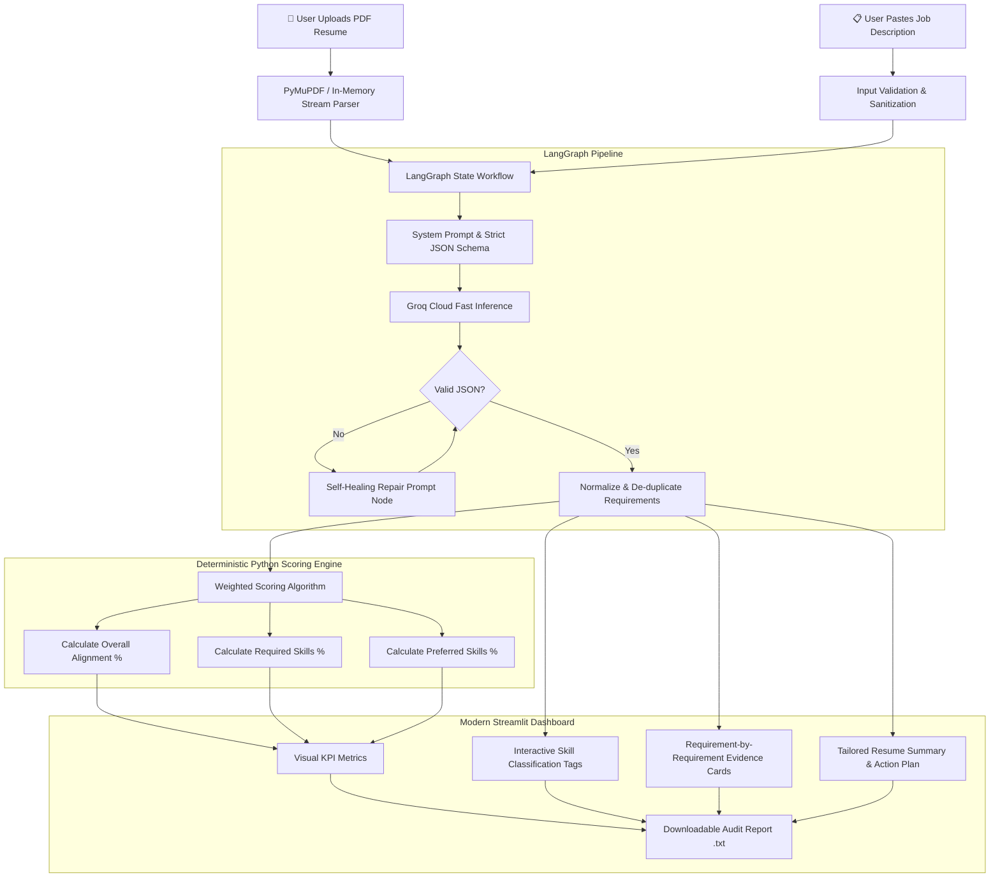

# ✦ JobFit AI — Evidence-Based Resume Alignment Engine

[](https://jobfit-ai-00.streamlit.app/)
[](https://www.python.org/)
[](https://github.com/langchain-ai/langgraph)
[](https://groq.com/)

> **JobFit AI** is an intelligent, transparent resume-to-job matching tool powered by **LangGraph** and **Groq LPUs**. Unlike standard "black-box" AI tools that hallucinate a random percentage match, JobFit AI enforces **deterministic scoring** and **verifiable quote-level evidence** extracted directly from your resume.

🔗 **Live Demo:** [https://jobfit-ai-00.streamlit.app/](https://jobfit-ai-00.streamlit.app/)

---

## ⚡ Why JobFit AI is Different

Most AI resume scanners suffer from two major flaws:
1. **Hallucinated Math:** They prompt an LLM: *"Rate this resume from 1-100"*. LLMs are stochastic text generators, not mathematical calculators—producing inconsistent, arbitrary numbers on every run.
2. **Unverifiable Claims:** They claim you are missing a skill even when it's clearly stated, or invent experience you don't have.

**JobFit AI solves this by separating qualitative reasoning from quantitative scoring:**
- **The LLM is strictly an Evidence Extractor:** It analyzes the Job Description (JD), identifies core vs. preferred requirements, and searches for exact quote excerpts in the resume.
- **Python is the Scoring Engine:** A deterministic algorithm computes exact weighted scores based on verifiable evidence levels (`supported = 1.0`, `partial = 0.5`, `not_found = 0.0`).
- **Explainable & Auditable:** Every point earned or lost is linked to an exact excerpt or a clear rationale.

---

## 🏗️ Architecture & Data Pipeline



---

## 📊 Scoring Methodology

### Formula

For each requirement $i$:

$$\text{Points Awarded}_i = \text{Priority Weight}_i \times \text{Evidence Value}_i$$

$$\text{Overall Score} = \text{round}\left(100 \times \frac{\sum \text{Points Awarded}_i}{\sum \text{Priority Weight}_i}\right)$$

```python
# Deterministic Python calculation
points_awarded = priority_weight * evidence_value
overall_score = round(100 * sum(points_awarded) / sum(priority_weights))
```

### Priority Weights
| Requirement Type | Weight | Description |
| :--- | :---: | :--- |
| **Required** | **2.0** | Mandatory prerequisites, core tech stack, hard requirements |
| **Preferred** | **1.0** | Good-to-have, bonus skills, or secondary qualifications |

### Evidence Scale
| Classification | Value | Criteria |
| :--- | :---: | :--- |
| **Supported** | **1.0** | Direct, verbatim/credible evidence exists in the resume |
| **Partial** | **0.5** | Tangential or related experience present, but not fully demonstrated |
| **Not Found** | **0.0** | No credible evidence detected in the resume text |

> *Note: "Not found" simply indicates the uploaded resume does not clearly surface the skill; it does not claim the candidate cannot perform it.*

---

## ✨ Features

- **Safe, In-Memory PDF Extraction:** Uses `PyMuPDF` to read byte streams without persisting sensitive candidate documents to disk. Encrypted PDF detection included.
- **Ultra-Fast LLM Inference:** Powered by Groq's LPU acceleration (supporting models such as `llama-3.3-70b-versatile`, `qwen/qwen3.8-27b`, etc.) with sub-second token generation.
- **Self-Healing Output Parser:** Includes an automatic retry/repair mechanism to fix truncated or malformed LLM JSON output without failing the user session.
- **Interactive Breakdown:**
  - Metric summary cards (Overall, Required, Preferred).
  - Categorized tag cloud (Evidence Found, Partial Evidence, Missing/Not Found).
  - Drill-down expander cards showing exact quotes from both JD and Resume.
- **Actionable Career Guidance:** Generates honest resume revision recommendations and a tailored, hallucination-free executive summary.
- **Exportable Audit Report:** One-click download of a clean plaintext audit log.

---

## 🛠️ Tech Stack

- **Core Logic:** Python 3.10+
- **Agentic Orchestration:** LangGraph, LangChain Core
- **LLM Provider:** Groq Cloud API (`ChatGroq`)
- **Frontend / UI:** Streamlit (Custom Dark Theme with responsive CSS)
- **Document Processing:** PyMuPDF (`fitz`)
- **Configuration & Security:** `python-dotenv`

---

## 🚀 Getting Started

### Prerequisites
- Python 3.10 or higher installed.
- A free Groq API key from [Groq Console](https://console.groq.com/keys).

### Installation & Run

1. **Clone the repository:**
   ```bash
   git clone https://github.com/ArnavP2305/jobfit-ai.git
   cd jobfit-ai
   ```

2. **Create and activate a virtual environment:**
   ```bash
   # Windows
   python -m venv venv
   .\venv\Scripts\activate

   # macOS / Linux
   python3 -m venv venv
   source venv/bin/activate
   ```

3. **Install dependencies:**
   ```bash
   pip install -r requirements.txt
   ```

4. **Set your Groq API key:**
   Create a `.env` file in the root directory:
   ```env
   GROQ_API_KEY=your_groq_api_key_here
   ```

5. **Launch the application:**
   ```bash
   streamlit run app.py
   ```

The application will open in your default browser at `http://localhost:8501`.

---

## 📂 Project Structure

```plaintext
jobfit-ai/
├── app.py                 # Streamlit UI, custom styling, and layout
├── requirements.txt       # Production dependencies
├── .env                   # Local API key configuration (git-ignored)
├── .gitignore             # Ignored environments, cache, and secrets
├── README.md              # Project documentation & architecture
├── graph/
│   ├── __init__.py
│   └── workflow.py        # LangGraph state definition, prompts, JSON repair & scoring
└── utils/
    ├── __init__.py
    └── pdf_parser.py      # In-memory PDF text extraction with PyMuPDF
```

---

## 🔍 Limitations & Responsible AI

- **OCR Limitation:** Scanned PDF resumes containing raster images without embedded text layers require an OCR pre-processor.
- **Advisory Role:** JobFit AI evaluates *text alignment*, not human capability. It does not replace a human recruiter and should not be used as an automated gating filter.
- **Privacy:** Resume and job description text are transmitted to the Groq API for inference in accordance with Groq's data privacy policies.
